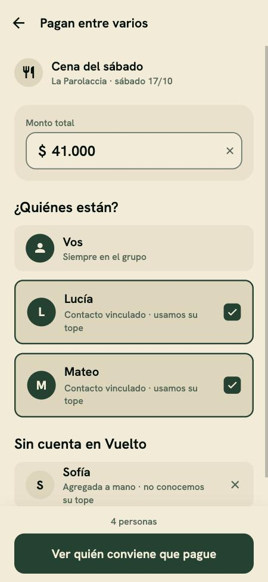
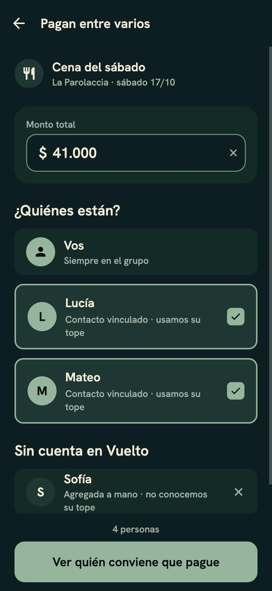
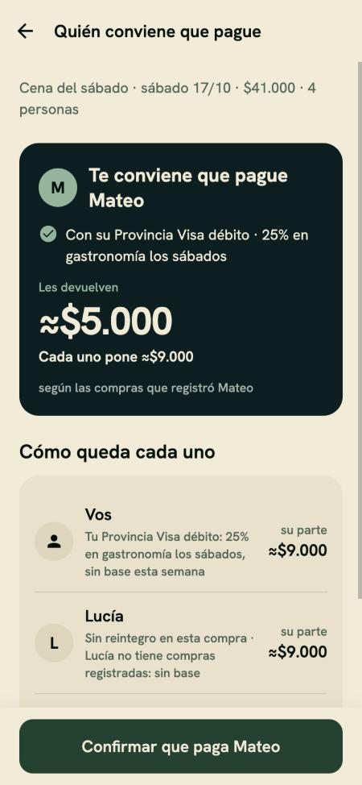
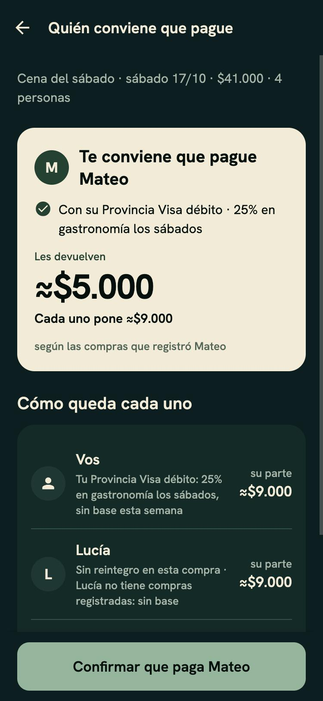
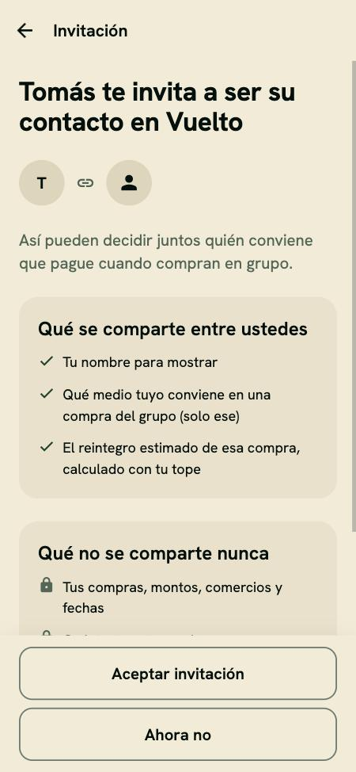

# Revisión del flujo de gasto compartido

Fecha: 10/11/2026. Alcance: contactos vinculados y gasto en grupo (RF-19 a RF-22,
ADR-008). Es una revisión, no un cambio: no toca código de la app ni del backend.
Cada hallazgo trae su evidencia (archivo:línea) y la corrección que proponemos, para
convertirlo en issue.

**En una línea:** las seis pantallas del flujo existen y cumplen lo que el diseño
pide (spec 006 US5), pero corren sobre datos de ejemplo. No hay tablas, funciones ni
Edge Function (#54/#56), y con una cuenta real el flujo miente en tres cosas: "Vos"
se evalúa con las compras de Martín, todos tienen de contactos a Lucía y Mateo, y un
comercio escrito a mano cuelga la pantalla de resultado.

## 1. Flujo esperado

Fuentes: `docs/decisions/008-contactos-vinculados-gasto-en-grupo.md`,
`docs/product/requisitos.md` (RF-19 a RF-22) y `specs/006-app-mobile-pantallas/spec.md`
(US5 y FR-023 a FR-028).

1. **Invitar** (Perfil → Contactos → Invitar a alguien): link y QR de un solo uso que
   vencen a las 24 h. No hay buscador de usuarios (RF-21, FR-025).
2. **Aceptar** (`/i/<token>`): la pantalla dice quién invita, qué se comparte, qué no y
   qué se puede deducir. "Aceptar" y "Ahora no" pesan igual y no hay nada
   preseleccionado. Una invitación vencida, usada, propia o de alguien que ya es
   contacto no crea vínculo. Sin cuenta, el usuario pasa por el registro y vuelve a
   aceptar (ADR-008 §1).
3. **Quitar** (sheet de confirmación): el vínculo se rompe para los dos y la próxima
   recomendación de cualquiera ya no puede incluir al otro (RF-22, FR-026).
4. **Armar el grupo** (desde "¿Pagan entre varios?" en el paso 3 de «+»): monto, "Vos"
   fijo, contactos con check y gente sin cuenta (solo el nombre, FR-024).
5. **Resultado**: quién conviene que pague, con qué medio, reintegro estimado con su
   base en palabras y la parte de cada uno. Nunca topes, cantidad de compras ni otros
   medios de un contacto (FR-023), ni estados de cobro (FR-027).

Reglas del motor (ADR-008 §5, RF-19): el motor es una función pura que recibe un
snapshot `integrantes[]`; maximiza el reintegro estimado de esta compra; **ante un
empate gana quien pide la recomendación y, entre los demás, el orden canónico por
id**; mismo grupo, compra y estado dan siempre la misma recomendación.

## 2. Flujo real recorrido

Se recorrió en la app web (`mobile-web`, 375×812) en claro y oscuro. Capturas en
`docs/design/capturas-grupo/`.

**Cómo se recorrió.** La app no deja entrar sin Supabase y en esta máquina no había
Docker ni credenciales. Para ver las pantallas se usó un cambio local temporal (sesión
de ejemplo y el perfil de Martín) que **se revirtió antes de commitear**. Por eso no se
incluye la captura de Perfil, que mostraba un aviso de "sin conexión" propio de ese
atajo. Lo que se vio es el comportamiento sobre datos de ejemplo.

| Paso | Cómo se verificó | Resultado |
|---|---|---|
| Contactos | Observado | Lista con Lucía y Mateo, quitar por fila e "Invitar a alguien" |
| Invitar | Observado | QR + link `vuelto.app/i/k7Qm2x`, "Vence en 24 h · sirve una sola vez", qué se comparte y qué no. Sin buscador |
| Quitar | Observado el sheet (no se confirmó el borrado) | Explica que el vínculo se corta para los dos |
| Aceptar `demo-tomas` | Observado | Quién invita, qué se comparte, "Aceptar" y "Ahora no" con el mismo peso |
| Aceptar `demo-vencida` | Observado | "Esta invitación venció" y solo "Volver" |
| Aceptar propia, usada, ya contacto | Solo lectura de código (`app/i/[token].tsx:22-27`) | Un texto por motivo |
| Armar (grupo de ejemplo) | Observado | Cena del sábado, $41.000, 4 personas |
| Resultado (grupo de ejemplo) | Observado | "Te conviene que pague Mateo con su Provincia Visa débito", ≈$5.000, "según las compras que registró Mateo", cada uno pone ≈$9.000 |
| Armar y resultado con comercio fuera del catálogo | Observado | Falla (ver G-04) |
| Armar sin contactos | Observado | Botón deshabilitado (ver G-11) |

**Lo que cumple el diseño:** no hay buscador; de los contactos solo se ve el medio que
se recomienda y el reintegro con su base en palabras ("Lucía no tiene compras
registradas: sin base"); no hay topes, cantidad de compras ni estados de cobro; las
cifras estimadas llevan ≈; "Aceptar" y "Ahora no" tienen el mismo peso.

| Claro | Oscuro |
|---|---|
|  |  |
|  |  |
|  |  |

Las demás capturas están en la carpeta: contactos, invitar y quitar en claro y oscuro,
aceptar vencida y resultado de comercio libre solo en oscuro, y armar sin contactos en
los dos.

## 3. Hallazgos

Severidad: **Alta** = el flujo da un resultado equivocado o se cuelga con una cuenta
real; **Media** = contradice el ADR o el diseño; **Baja** = detalle o deuda conocida.
"Observado" quiere decir que se reprodujo en la app; "Código" que se confirmó leyendo.

### Alta

**G-01 · "Vos" y las promos salen de los fixtures.** Código (con los medios de Martín
el resultado coincide, por eso no se ve al recorrer la app).
- `apps/mobile/src/data/grupo-simulado.ts:37-44` arma a "Vos" con `mediosDeclarados` y
  `comprasOctubre`, no con el perfil ni las compras del store.
- `grupo-simulado.ts:19,52` evalúa con `promociones` de `fixtures.ts`, no con el
  corpus sincronizado (#42).
- Efecto: una cuenta real recibe la recomendación de grupo calculada con Martín y las
  promos de ejemplo.
- Corrección: mientras no exista la Edge Function, que `recomendarGrupo` reciba los
  medios, las compras y el corpus del store (selectores existentes) para "Vos". Lo de
  los contactos sigue simulado hasta #56.

**G-02 · Todas las cuentas tienen de contactos a Lucía y Mateo.** Código.
- `apps/mobile/src/store/contactos.ts:12` arranca con `fixtures.contactos`, y
  `sesionCerrada` (`:29`) vuelve a ellos.
- Efecto: un usuario nuevo ve "Contactos 2", puede armar grupos con personas que no
  existen y nunca ve el estado vacío ("Todavía no tenés contactos") que ya está
  diseñado en `app/contactos/index.tsx:23-32`.
- Corrección: lista vacía por defecto; los fixtures solo en el escenario de demo
  (`escenarioElegido`).

**G-03 · Los contactos no persisten.** Código.
- `apps/mobile/src/store/persistencia.test.ts:64` fija que los contactos no se
  guardan. Quitar a Mateo y reiniciar la app lo trae de vuelta; aceptar a Tomás y
  reiniciar lo borra.
- Efecto: el vínculo "roto para los dos" (RF-22) reaparece solo.
- Corrección: hasta que la lista salga de Supabase (#56), persistirla junto al perfil,
  o sacarla de la app real (junto con G-02).

**G-04 · Un comercio fuera del catálogo deja el resultado cargando para siempre.**
Observado (ver `armar-comercio-libre-oscuro.jpg` y `resultado-comercio-libre-oscuro.jpg`).
- Cómo se llega: un comercio habitual escrito a mano se resuelve como `libre-<nombre>`
  (`apps/mobile/src/data/calculo.ts:313-324`); `selectComerciosFrecuentes`
  (`store/selectores.ts:49-53`) lo ofrece en el paso 1 de «+», y el paso 3 muestra
  "¿Pagan entre varios?" para cualquier recomendación
  (`app/comprar/recomendacion.tsx:70-74`) y manda ese id a `/grupo/armar`.
- `data/api.ts:37-41` (`comercioPorId`) solo conoce el catálogo y lanza
  `Comercio desconocido`.
- `app/grupo/armar.tsx:37` ignora el error: el encabezado del comercio desaparece sin
  aviso. `app/grupo/resultado.tsx:27-31` también lo ignora: queda el esqueleto, sin
  mensaje, sin botón y sin error en consola.
- Además, aunque se resolviera, un comercio sin rubro no se puede evaluar
  (`grupo-simulado.ts:47`, `categoriaId === null`) y todos quedarían "sin promo".
- Corrección: (1) que `armar` y `resultado` reciban el `Comercio` ya resuelto por
  `selectComercioSimulado` en vez del id; (2) no ofrecer "¿Pagan entre varios?" si el
  comercio no tiene rubro; (3) que `resultado` muestre `error` con "Reintentar"
  (`useAsync` ya expone `error` y `recargar`).

**G-05 · Faltan estados de error en cuatro pantallas.** Código.
- `app/contactos/quitar.tsx:22-29`: sin `try/catch`; si falla, el botón queda en
  "cargando" y no se sale.
- `app/contactos/invitar.tsx:35-36`: usa `inv.datos` y ignora `inv.error`; si falla,
  el QR queda en esqueleto.
- `app/grupo/armar.tsx:37` y `app/grupo/resultado.tsx:27-31`: ver G-04.
- Hoy no se ve porque los mocks no fallan. Con el backend real, sí.
- Corrección: el mismo patrón que `i/[token].tsx:58-71`, que ya muestra el error y
  deja reintentar.

**G-06 · El link de invitación no abre la app.** Código.
- `invitar.tsx:40,44,58` comparten y codifican `https://vuelto.app/i/<token>`.
- `apps/mobile/app.json:6` define solo `"scheme": "vuelto"`: no hay
  `associatedDomains` (iOS) ni `intentFilters` (Android). Tocar o escanear el link
  abre el navegador, no la app. `docs/architecture/03-frontend.md:51` documenta
  `vuelto://i/<token>`; ADR-008 pide "un deep link de la app".
- Hay una decisión pendiente (dominio, ver `pendientes.md`, "Nombre final + dominio").
- Corrección, a elegir: (a) universal links y app links con `vuelto.app` y una página
  que redirija (necesita el dominio y un build de EAS); o (b) para el MVP compartir
  `vuelto://i/<token>` (en Expo Go, `exp://…/--/i/<token>`). Recomendamos (a) si el
  dominio está, (b) si no.

**G-07 · "Ya tengo cuenta" pierde la invitación.** Código.
- `app/i/[token].tsx:51-56` guarda `invitacionPendiente` y manda a Bienvenida.
- Se consume en un solo lugar: `app/(onboarding)/primera-respuesta.tsx:33-45`, al cerrar
  el onboarding. Quien elige "Ya tengo cuenta" y ya tiene medios en Supabase entra
  directo a las tabs, no pasa por ahí, y la invitación queda guardada sin abrirse.
- Corrección: consumir `invitacionPendiente` en `app/(tabs)/_layout.tsx` cuando hay
  usuario y perfil listo (`router.replace('/i/<token>')`), y dejar a
  `primera-respuesta` solo la limpieza.

### Media

**G-08 · El desempate no es el del ADR.** Código.
- `grupo-simulado.ts:163-167` ordena por reintegro, después por "el estimado con base"
  y después por `orden`. ADR-008 §5 y RF-19: primero quien pide, después orden
  canónico por id.
- `orden` es la posición del integrante en el pedido (`armar.tsx:57-61`), o sea el
  orden de la lista de contactos, que cambia al agregar y quitar
  (`store/contactos.ts:19`). El mismo grupo puede dar recomendaciones distintas según
  cómo esté ordenada la lista, contra "mismo grupo, compra y estado dan siempre la
  misma recomendación".
- `data/api.test.ts:64-76` fija el criterio de la base. El comentario del propio código
  dice "El desempate definitivo es de #56".
- Corrección: ordenar por id canónico. Si queremos que la base cuente (la tarjeta de
  decisión es más creíble con base), enmendar ADR-008 §5 primero; hoy no está.

**G-09 · «Confirmar» no hace nada más que mostrar un aviso.** Código.
- `app/grupo/resultado.tsx:33-42`: toast y `dismissAll`. En el flujo individual, «Usar»
  crea una compra por confirmar (spec 012, #109).
- ADR-008 §6: cada uno registra sus propias compras. Entonces, si paga otro, no hay
  nada que crear. Si paga "Vos", el flujo debería igualar al individual.
- Corrección propuesta: si `quienPaga.esVos`, crear la compra por confirmar con el
  medio recomendado; si paga otro, dejar el aviso y que el texto diga que cada uno
  registra lo suyo. Decisión de producto antes de implementar.

**G-10 · La división no cierra.** Código.
- `grupo-simulado.ts:184`: `Math.round((monto - reintegro) / n)`. Con $10.000 entre 3
  y sin reintegro, cada uno pone $3.333 y la suma da $9.999. Abierto en
  `pendientes.md` ("redondeo de la división") y en ADR-008 §8.
- Además la parte es igual para todos aunque pague uno solo, y la fila dice "su parte"
  (`resultado.tsx:119-129`), que suena a deuda cuando la pantalla aclara que no se
  cobra.
- Corrección: repartir el resto de a $1 siguiendo el orden canónico (de G-08), para
  que la suma sea exacta, y decir "pone" en vez de "su parte". RF-20: la división se
  genera sola, nunca se carga a mano.

**G-11 · Sin contactos, el grupo es un callejón.** Observado
(`armar-sin-contactos-*.jpg`).
- `app/grupo/armar.tsx:46`: hace falta al menos otra persona. Con cero contactos y
  ninguna persona sin cuenta, el botón queda deshabilitado con "1 persona · sumá a
  alguien más".
- Y si se suma a alguien sin cuenta, ese integrante no tiene tope conocido: la
  recomendación solo puede evaluar a "Vos" y termina en "pagá vos" o en "nadie tiene
  reintegro", sin decir por qué (`docs/design/ideas-ux.md:98-99` ya lo marcaba como
  callejón).
- Inconsistencia de docs: `privacidad.md:21,111-113` dice que los integrantes sin cuenta
  se declaran con nombre **y medios**; spec 006 FR-024 y la app, solo con el nombre.
- Corrección: estado vacío en Armar ("Invitá a alguien para que Vuelto decida con sus
  topes") que lleve a Invitar; decidir lo de los medios de la gente sin cuenta; avisar
  en el resultado cuando nadie más tiene datos.

### Baja

**G-12 · El reloj del "servidor" no es el de la app.** Código.
- `data/api.ts:44,163` usa `RELOJ_EJEMPLO` (14/10/2026); Armar usa `selectHoy` del
  store (`armar.tsx:29,34`), que con el corpus sincronizado es la fecha real.
- Cuando difieren, `cuandoTexto` (`grupo-simulado.ts:61-64`) cae en la rama "no es hoy":
  "martes 10/11" en vez de "hoy martes".
- Corrección: pasar `hoy` en el pedido. En el servidor real no pasa, pero el contrato
  debería tenerlo explícito (ADR-010: el reloj entra como valor).

**G-13 · Las compras de los contactos viajan en el bundle.** Código, deuda conocida.
- `data/fixtures.ts:298` (`datosDeContactos`) y `grupo-simulado.ts:5-8`. Son datos de
  personas de ejemplo, así que hoy no expone a nadie, pero ADR-008 §3 prohíbe que las
  compras de un contacto lleguen al celular. Se borra con #56.
- Corrección: borrar `grupo-simulado.ts` y `datosDeContactos` en el mismo PR que
  conecte la Edge Function, y no dejar que ningún build con contactos reales los
  incluya.

**G-14 · Los docs no se ponen de acuerdo en nombres.** Doc.
- `01-data-models.md` llama a las tablas `invitacion` y `contacto` (singular);
  `specs/007-esquema-supabase-rls/spec.md:187-189` pide plural y las tablas existentes
  son plurales (`compras`, `promociones`, `medios_de_pago`).
- Corrección: plural (`invitaciones`, `contactos`) y actualizar `01-data-models.md`.

## 4. Lo que falta del backend (#54/#56)

Hoy no hay migración, función SQL, Edge Function ni test pgTAP de contactos ni de
grupo. El motor tampoco tiene función de grupo: esa lógica vive en la app
(`grupo-simulado.ts`). Para cumplir RF-19 a RF-22 hace falta:

1. **Migración** (con RLS en la misma, regla del proyecto): `invitaciones` (emisor,
   hash del token, vence, usada) y `contactos` (par sin duplicados ni auto-vínculo,
   fecha). `contactos` visible para sus dos integrantes; `invitaciones` solo para su
   emisor; ambas en cascada con la cuenta.
2. **Funciones SQL** `security definer`, `set search_path`, ejecutables solo por
   `authenticated`: `aceptar_invitacion(token)`, `ver_invitacion(token)` (para la
   pantalla de aceptación: quién invita y el estado) y la que devuelve los datos de los
   contactos (medios, tope consumido agregado por promo y cantidad de compras), que
   verifica el vínculo con `auth.uid()` y rechaza un id no vinculado (ADR-008 §4).
   Quitar un contacto es un `delete` con RLS para sus dos integrantes.
3. **Edge Functions**: `invitacion` (genera el token aleatorio, guarda solo el hash,
   devuelve el link) y `recomendar-grupo` (handler → service → repositorios, ADR-009,
   con el JWT del usuario, nunca la service role key).
4. **Motor**: función pura de grupo sobre el snapshot `integrantes[]`, con los casos de
   ADR-008: tope ajeno agotado, contacto sin base, integrante sin cuenta y empate
   (G-08). Hoy no existe en `packages/motor`.
5. **App**: reemplazar los mocks de `data/api.ts` (`crearInvitacion`, `verInvitacion`,
   `aceptarInvitacion`, `quitarContacto`, `recomendarGrupo`), sincronizar la lista de
   contactos desde Supabase y borrar `grupo-simulado.ts` y `datosDeContactos`.
6. **Tests pgTAP** (`supabase/tests/database/`): vinculado, no vinculado y quitado;
   invitación vencida, usada, propia y de alguien que ya es contacto; `anon` sin
   permiso de ejecución.

### El choque con `estructura.test.sql`

`supabase/tests/database/estructura.test.sql:30-33` afirma "ninguna función
`security definer` en `public`", y es una protección útil. Pero ADR-008 §4
necesita funciones `security definer` que el cliente pueda llamar, y PostgREST solo
expone los schemas de `supabase/config.toml:13` (`public` y `graphql_public`). Una
función en otro schema no se puede llamar con `.rpc()`.

El precedente del repo es `private`
(`20261103000001_medios_de_pago_minimo_uno.sql:7-15`): ahí está el `security definer`,
con `revoke all on schema private from public, anon, authenticated`, pero esa función
es un trigger, no algo que el cliente llame. Opciones:

| Opción | Cómo | Costo |
|---|---|---|
| **A (recomendada)** | Schema propio (ej. `contactos_privado`) con las funciones `security definer`, y en `public` un wrapper `security invoker` por cada una que solo delega | El test sigue valiendo sin tocarlo. Hay que dar `usage` de ese schema a `authenticated` (no el de `private`, que sigue cerrado) y un wrapper por función |
| B | Aflojar el test con una lista de excepciones | Menos código, pero el test deja de proteger contra el próximo `security definer` en `public` |
| C | Agregar el schema a `api.schemas` de `config.toml` | Además hay que cambiar la configuración del proyecto alojado a mano; riesgo de que local y producción diverjan |

Recomendamos A. Decidirlo en la spec de #54/#56, antes de escribir la migración.

## 5. Orden sugerido

1. **Sin backend, se puede hacer ya** (cada uno es una issue chica): G-04 y G-05 (la
   pantalla no debe colgarse), G-01 y G-02 (que "Vos" y los contactos sean los de la
   cuenta), G-07 (invitación pendiente), G-11 (estado vacío).
2. **Decisiones de producto antes de código:** G-06 (dominio o esquema propio), G-08
   (¿cuenta la base en el desempate?), G-09 (qué hace «Confirmar»), G-10 (redondeo).
3. **Con el backend (#54/#56):** G-03, G-12, G-13, G-14 y la sección 4. Es una feature
   completa: sigue el ciclo de spec-kit (`/speckit-specify` → `spec-critic` →
   `/speckit-plan`).
